<div align="center">


# NetAnalyzer

### Investigate your network: firewalls, cloud logs and traffic, in one place

*Sherlock-style network forensics.* Turn raw logs into answers: which rules are dead, who is eating the bandwidth, which ports are
really used, where your traffic is going, what is failing behind your load balancer, and what is wrong in a packet capture — in one self-hosted dashboard.
Today it covers **SonicWall**, **FortiGate** and **AWS** (ALB, VPC Flow Logs, WAF); more sources are on the roadmap.

[](#-quick-start)
[](#-architecture)
[](#-architecture)
[](#-architecture)
[](#-environments)
[](#-behavior-world-map--heatmap)

**English** · [Português](README.pt-BR.md)

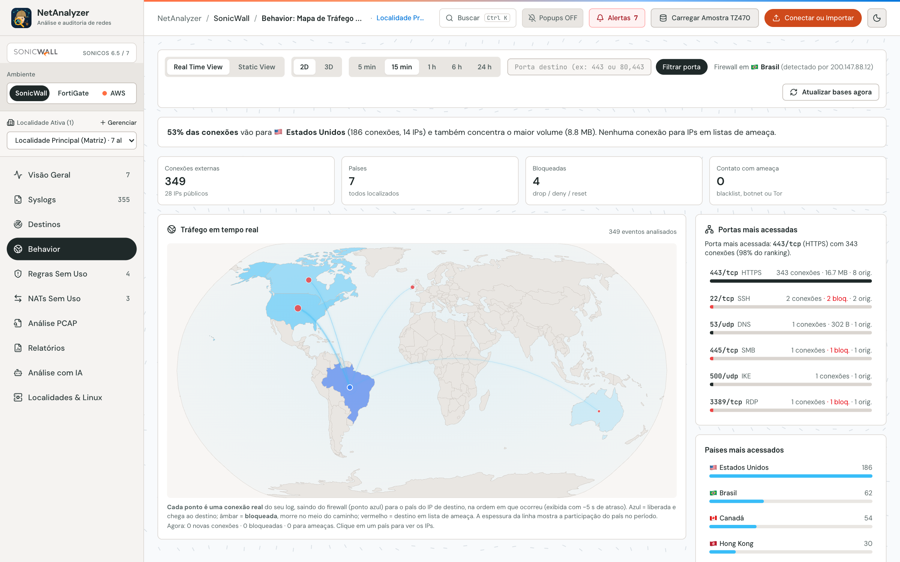

</div>

---

## ✨ Why NetAnalyzer

Networks and clouds produce logs faster than anyone can read them. NetAnalyzer connects to your appliance (API),
receives its syslog, reads your AWS logs from S3, and gives you the views an auditor or network engineer actually
needs — without sending a single log to a third-party service.

| | |
|---|---|
| 🔎 **Find dead rules** | Rules and NATs with no hits, ranked, using the appliance's own counters as the source of truth. |
| 🌍 **See where traffic goes** | Real-time world map and country heatmap, built from your real connections. |
| 🔌 **Know the ports** | Most-accessed destination ports and a destination-port filter in Syslogs, Destinations and Behavior. |
| 📊 **Know who consumes what** | Bandwidth per IP, category, country and destination. |
| 🧪 **Debug packet captures** | Upload `.pcap` / `.pcapng` and filter with Wireshark-style expressions; get probable causes automatically. |
| ☁️ **Read your AWS logs** | VPC Flow Logs, AWS WAF and ALB straight from S3, in the same views as the firewalls. |
| 📺 **Watch it on the wall** | TV mode for ALB, VPC Flow Logs and WAF, with trends, donuts and rankings. |
| 🚨 **Alerts that matter** | Anomaly spikes, IPS/malware events, scans, link saturation, license and sync problems. |
| 📑 **Hand over reports** | Audit report and Access & Consumption report, scheduled, static HTML, PDF and CSV. |
| 🔒 **Stay private** | Self-hosted. GeoIP, ASN and reputation lists run **offline**. |

---

## 🧩 Environments

One interface, three environments, switched in the sidebar. Each runs in its own container with its own data.

| | SonicWall | FortiGate | AWS |
|---|---|---|---|
| **Log source** | Syslog UDP `5514` + SonicOS API | Syslog UDP `5515` + FortiOS API | VPC Flow Logs, WAF and ALB read from **S3** |
| **Traffic direction** | Outbound to the internet | Outbound to the internet | Inbound clients and outbound flows |
| **Rules / NAT audit** | ✅ | ✅ (policies, VIPs) | — |
| **Everything else** | Syslogs, Destinations, Behavior, Ports, PCAP, Reports, Alerts | same | same, including the AI analyst with an AWS-specific context |

---

## 🌐 Behavior: world map & heatmap

Every dot on the map is **a real connection** taken from your logs, leaving toward the destination country, in the
order it happened. Blue = allowed and delivered, amber = blocked (it dies halfway), red = destination listed as a threat.
The origin country is detected automatically (on AWS it comes from the region).

<table>
<tr>
<td width="50%"><b>Real-time view</b><br></td>
<td width="50%"><b>Static view — country heatmap</b><br>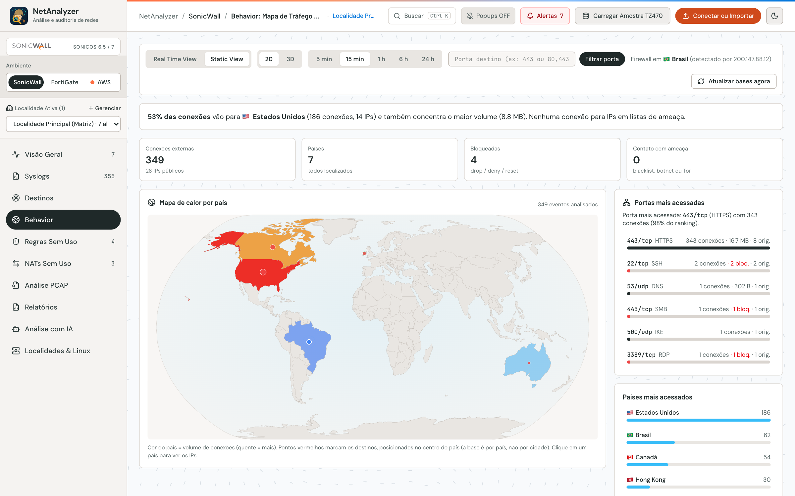</td>
</tr>
</table>

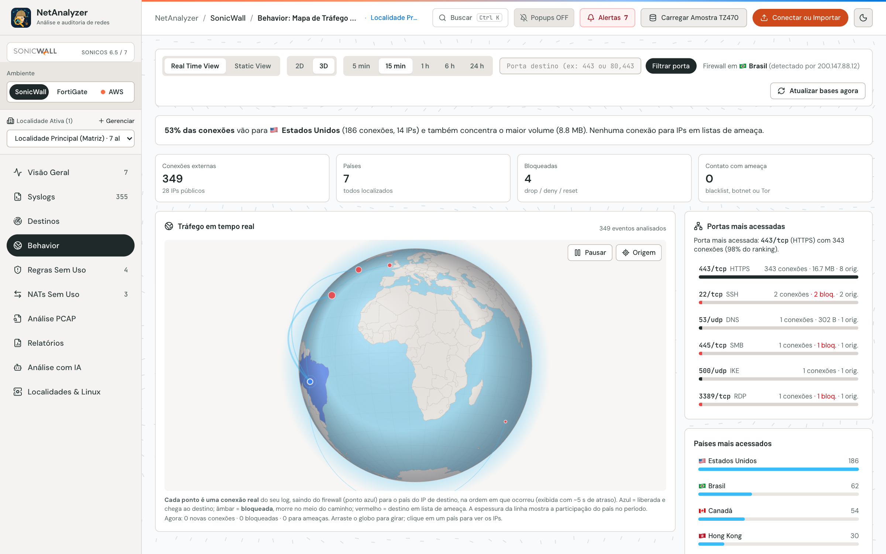

- **2D or 3D** — switch between the flat map and a **rotating 3D globe** (drag to spin, pause, re-center on the origin). Real connections fly along lifted arcs in both views.
- **Whole period, no event cap** — over long windows the database aggregates every connection (cached and refreshed in the background), so the map covers the full period instead of only the latest events.
- **Offline GeoIP / ASN / reputation** — no per-lookup API, no rate limits, nothing leaves your network.
  Sources: [DB-IP Lite](https://db-ip.com/db/lite.php) (CC BY 4.0), [FireHOL Level 1](https://iplists.firehol.org/),
  [Spamhaus DROP](https://www.spamhaus.org/drop/), [abuse.ch Feodo Tracker](https://feodotracker.abuse.ch/) and the Tor exit list.
- **One-click refresh** (*Update databases now*) plus automatic daily (lists) and monthly (GeoIP) updates.
- Time windows from **5 minutes to 24 hours**; click a country to list its IPs.
- Plain-language summary on top: *"53% of connections go to the United States… no connection to threat-listed IPs."*

> Country-level precision by design: the databases are offline and free; positions are country centroids.

---

## 🔌 Ports: most-accessed and filter by destination port

Syslogs, Destinations and Behavior share the same port tools.

<table>
<tr>
<td width="50%"><b>Syslogs</b> — ranking + port filter<br>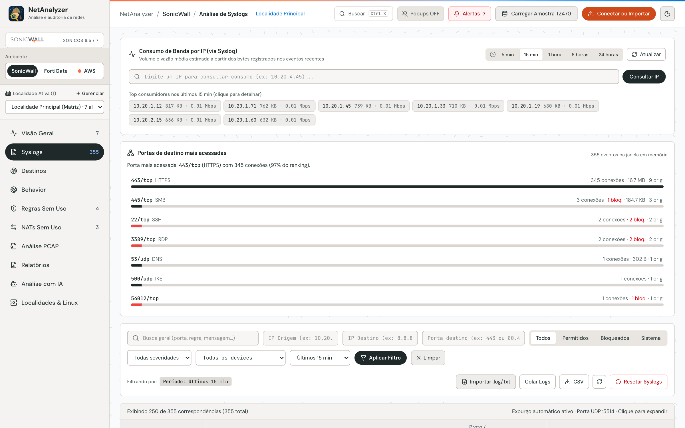</td>
<td width="50%"><b>Destinations</b> — ranking + port filter<br>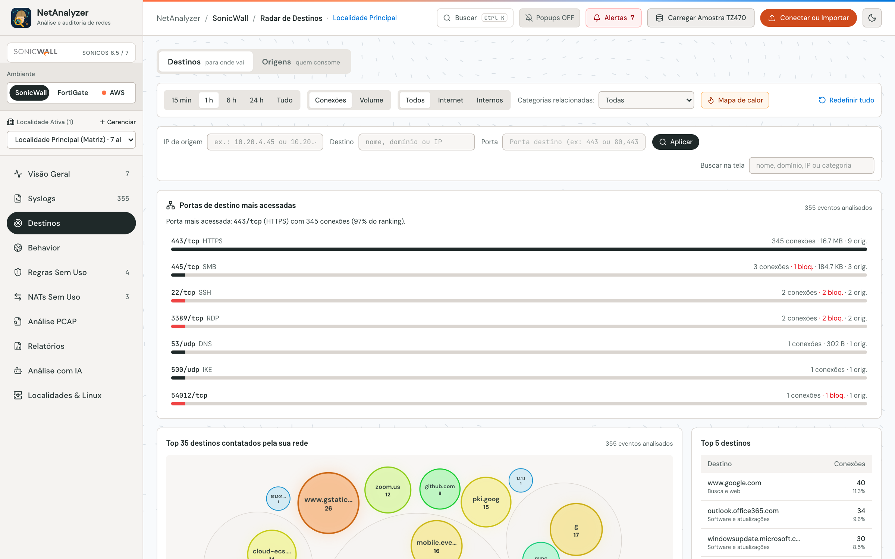</td>
</tr>
</table>

- **Ranking** of destination ports with service name (HTTPS, SSH, RDP…), connections, blocked share, volume and distinct sources.
  The headline says it in words: *"Most accessed port: 443/tcp (HTTPS) with 345 connections."*
- **Click a port to filter**; click again to clear. The ranking keeps showing the alternatives while a filter is active.
- **Port filter field** accepts `443`, lists (`80,443`) and ranges (`8000-8100`), combined (`22,8000-8100`).
- In Syslogs the ranking is computed in the database over the whole selected period.

---

## ☁️ AWS environment

Read your cloud logs straight from **S3 or CloudWatch Logs** and see them in the same views as the firewalls.

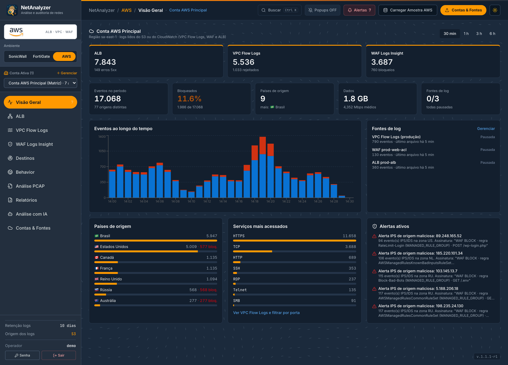

### 📺 TV mode: your cloud on one screen

One click on **TV mode** (*Modo TV*) turns the **ALB**, **VPC Flow Logs** or **WAF** dashboard into a NOC wall screen: full screen, dark theme, a clock and what matters in sight.

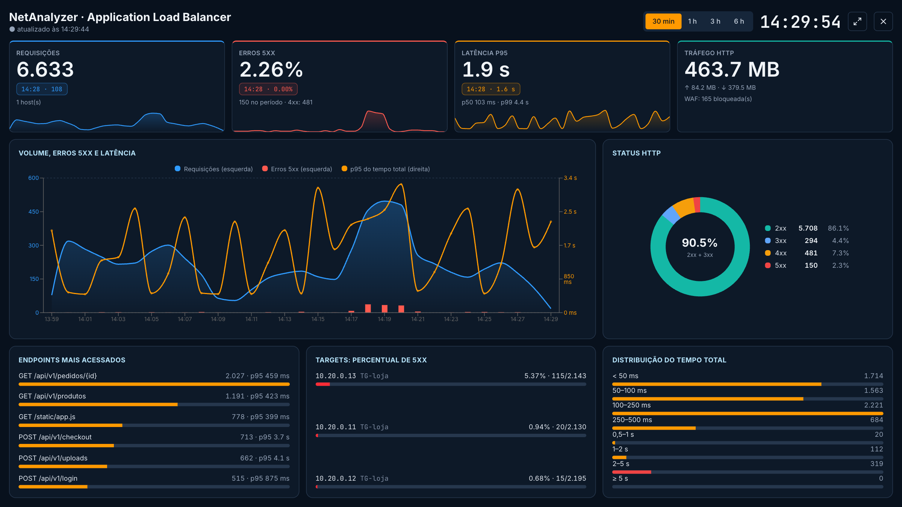

<table>
<tr>
<td width="50%"><b>WAF</b> — what was blocked, by which rule, from where<br>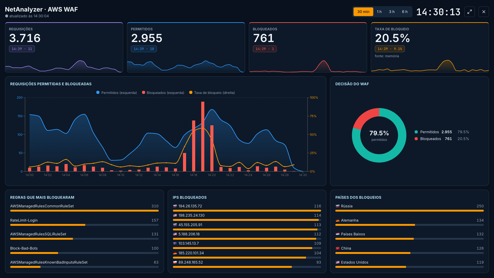</td>
<td width="50%"><b>VPC Flow Logs</b> — rejections, targeted ports and consumption<br>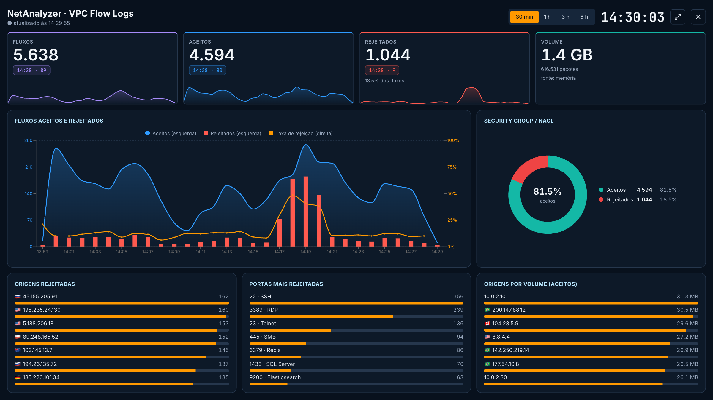</td>
</tr>
</table>

- Data is fetched every **60 s** while the tab is visible; the screen warns when a request fails or the response is older than 3 minutes (this alone does not tell whether AWS collection has stopped).
- Period selector (30 min to 6 h), full-screen button, `Esc` to leave, and a request to the browser to keep the display awake.

### 📈 Dashboards that tell the story

- **Trend cards:** period total, an area sparkline and the value of a recent interval, with its time.
- **Dual-axis timeline:** on ALB, requests, 5xx errors and **p95 latency**; on WAF and VPC, allowed, blocked and **block/reject rate**.
- **Donuts** for HTTP status and decisions (allowed vs blocked), with counts and percentages.
- The axis covers exactly the selected period, up to now.

**Application Load Balancer:** where it is slow, what fails and who is affected.

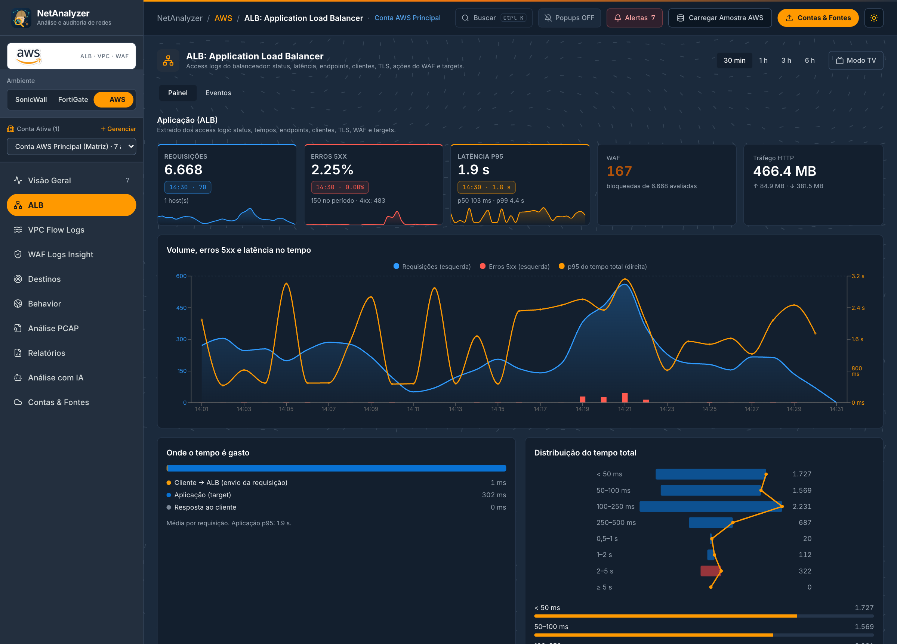

**AWS WAF:** when the attack happened, which rules reacted and where it came from.

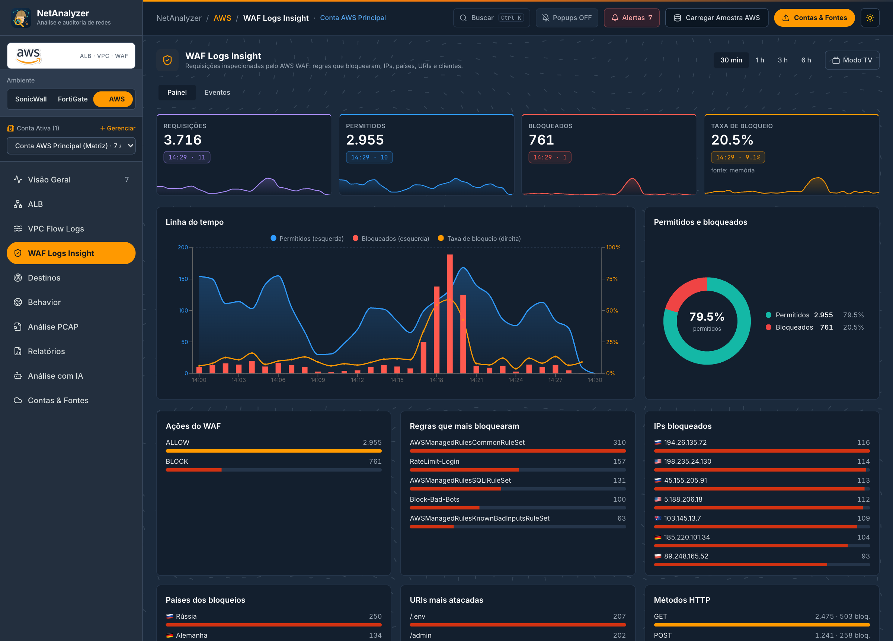

**VPC Flow Logs:** what the Security Group and NACL accepted and rejected.

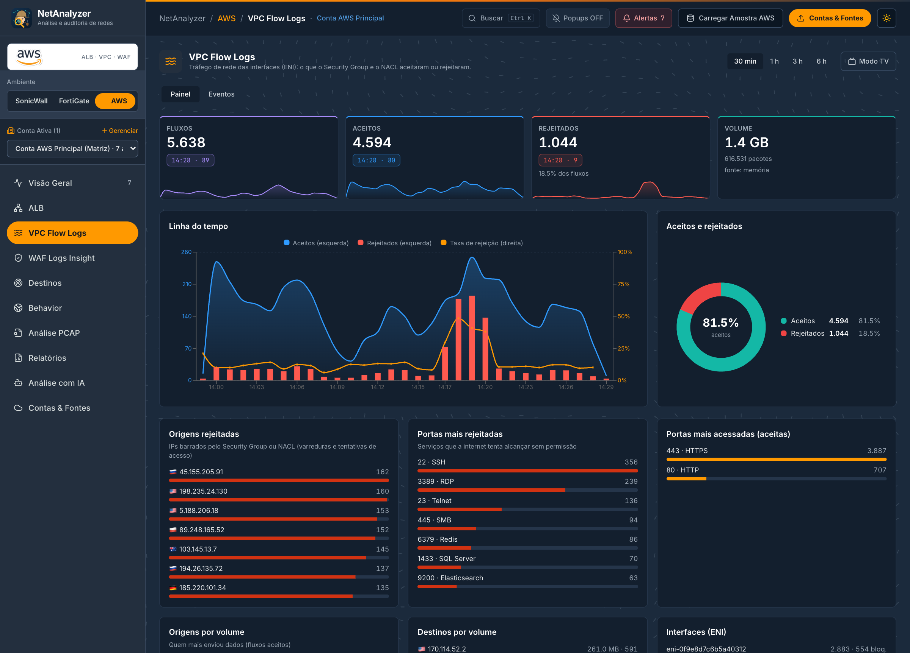

> The overview, the three dashboards and TV mode screenshots use **fictitious demo data** (the UI is in Portuguese).

<table>
<tr>
<td width="50%"><b>Behavior</b> — clients by country, region-based origin<br>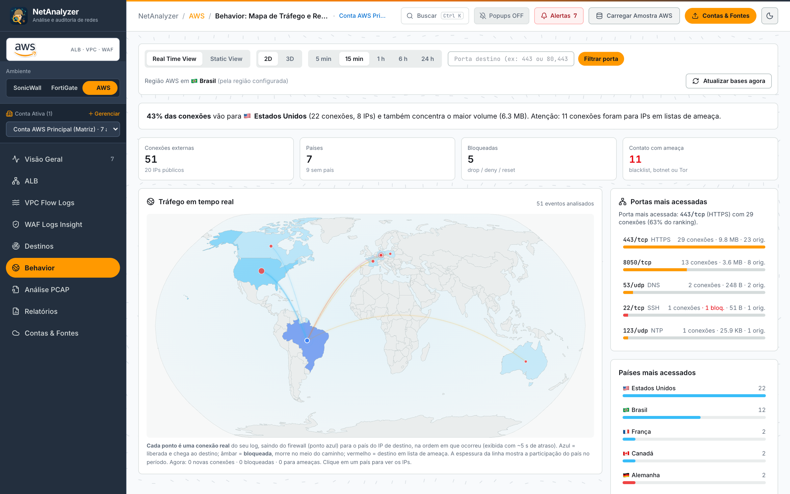</td>
<td width="50%"><b>Accounts &amp; S3 sources</b><br>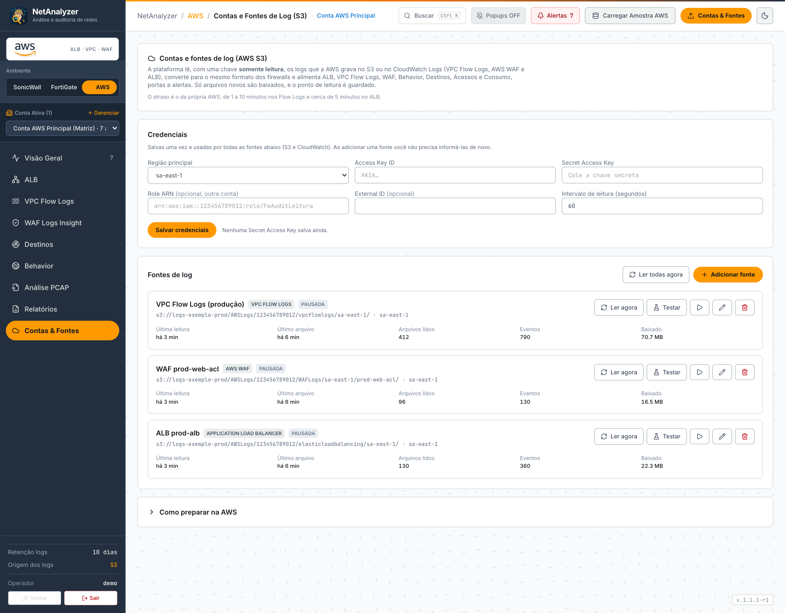</td>
</tr>
</table>

| Log | Format read | What you get |
|---|---|---|
| **VPC Flow Logs** | text, default or custom fields (`pkt-srcaddr`, `flow-direction`…) | ACCEPT/REJECT, IPs, ports, protocol, bytes; port scans against your instances |
| **AWS WAF** | JSON, one request per line | ALLOW/BLOCK, terminating rule, client IP and country, Host |
| **Application Load Balancer** | access log: text (S3, `.gz`) or JSON (CloudWatch) | client, host, method, path, status, 3 timings, TLS, user-agent, WAF action, target, bytes in/out |

- **S3 or CloudWatch Logs:** each source reads either a bucket or a log group. In CloudWatch a **stream prefix** (e.g. `ALB_Access_Logs/`) separates log types that share one group, so connection and health-check logs stay out.
- **Menu:** the AWS environment has one page per resource — **ALB**, **VPC Flow Logs** and **WAF Logs Insight** — each with a dashboard (top-N panels, timeline) and an events explorer; plus Destinations, Behavior, PCAP, Reports and Accounts & Sources. Pick the log group and stream prefix with a refresh button that lists them from AWS.
- **Application insights (ALB):** a full section with HTTP status mix, latency, most-used / slowest / heaviest endpoints (ids grouped as `{id}`), endpoints with errors, user-agents, TLS versions and ciphers, WAF actions and per-target health. Every field is also kept on the event and shown in the Syslogs detail row.
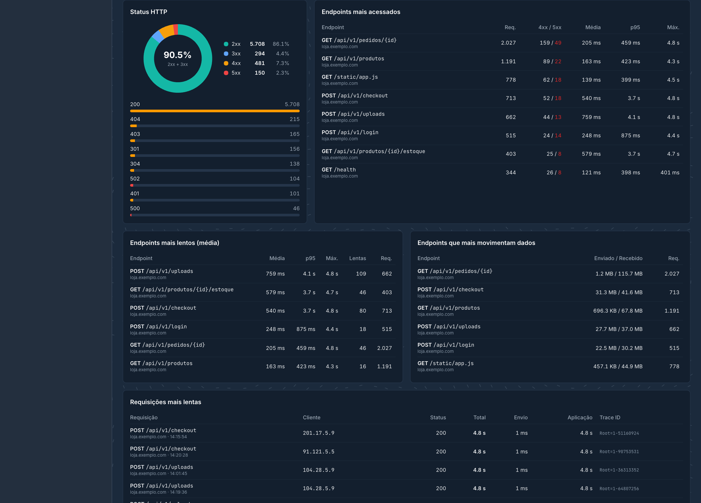

- **Latency, properly:** p50 / p95 / p99, where the time goes (client → ALB, application, response), a time distribution, per-endpoint p95, a latency + 5xx timeline and the slowest individual requests with their Trace ID. Long "send" times are flagged as slow client uploads, not a slow server.
- **Connection logs (TLS):** handshake latency, TLS version and key exchange (including post-quantum `X25519MLKEM768`), and connections that never completed TLS.
- **Secrets never stored:** `Authorization`, cookies, API keys and token-like query parameters are redacted before anything is saved or shown; only the auth *scheme* (Bearer, Basic, SigV4…) is kept as a metric.
- **How it works:** every ~60 s (configurable) the platform lists only the **new** objects of each source, downloads, decompresses, converts them
  to the common event and ingests. The read position is persisted, so a restart never repeats or loses files. The first read looks back a configurable
  window (default 6 h).
- **Read-only access:** an IAM user with `s3:ListBucket` + `s3:GetObject` on the log prefix. The secret is **stored encrypted** and never returned to the browser.
  Optional **AssumeRole + ExternalId** for another account.
- **Test before saving:** validates credentials, bucket and prefix, and tries to recognise the format of a sample object, with clear messages for
  `AccessDenied`, wrong region, bad key, and so on.
- **Inbound-aware:** in Behavior and Access reports the public client IP is the remote side, so the map shows *who is reaching you*.
- **Delay is AWS's own:** 1–10 min for Flow Logs, ~5 min for ALB. The cheapest delivery is S3 (about half the cost of CloudWatch ingestion).
- No UDP listener, no rules/NATs: the AWS environment only shows what comes from the cloud logs. **Load sample (AWS)** fills every screen with demo data.

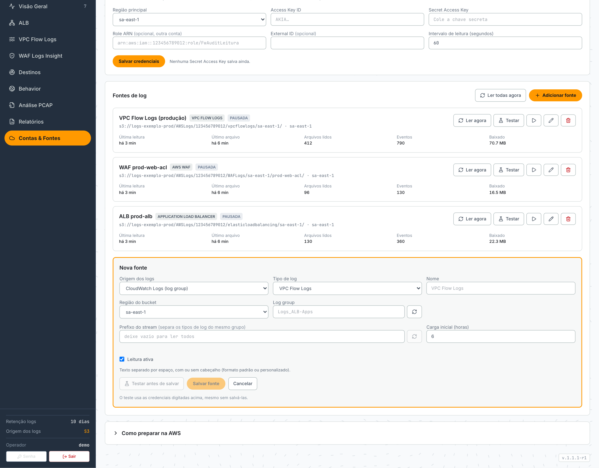

---

## 🧪 PCAP analysis

Upload captures from Wireshark or tcpdump and debug with **Wireshark-style display filters**, without installing anything.

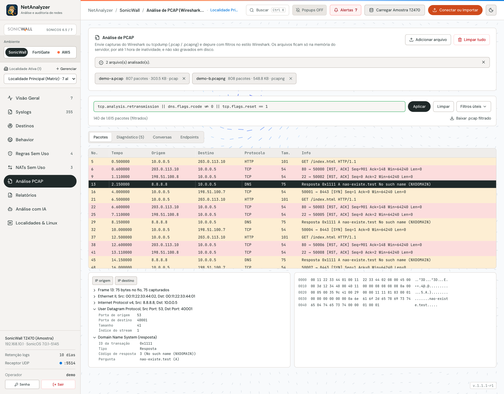

- **Multiple files** (`.pcap` and `.pcapng`, little/big-endian, µs/ns) merged by timestamp; kept **in server memory only**, up to 1 h idle.
- **Filters:** `ip.addr == 10.0.0.0/8`, `tcp.port in {80 443}`, `tcp.flags.syn == 1 && tcp.flags.ack == 0`, `dns.qry.name contains "microsoft"`,
  `tls.handshake.extensions_server_name`, `http.response.code >= 400`, `tcp.analysis.retransmission`, `tcp contains "text"` and more.
  Operators `== != > < >= <= contains matches in {…}`, logic `&& || !` (or `and / or / not`), CIDR on IP fields. A built-in menu of useful filters and friendly errors for unknown fields.
- **Packet list** coloured by problem and protocol, layer tree and hexdump, **Follow TCP stream**, conversations and endpoints, and **Download filtered .pcap** to open in Wireshark.
- **Diagnostics with probable causes** (click *View packets* to jump to the exact filter):

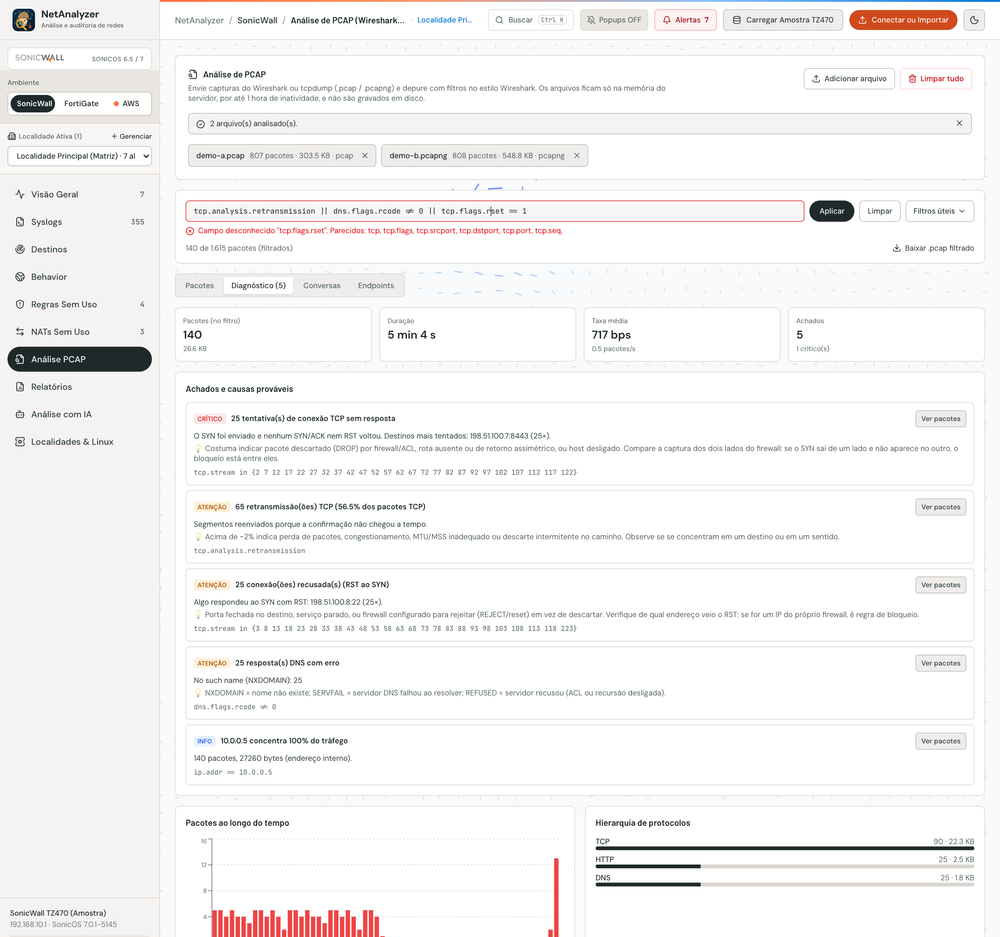

| Finding | What it usually means |
|---|---|
| SYN with no reply | Packet dropped by a firewall/ACL, missing route, or host down |
| RST in answer to SYN | Closed port, stopped service, or a firewall configured to reject |
| Retransmissions, zero window, duplicate ACKs | Loss, congestion, MTU/MSS, slow receiver |
| DNS errors / queries with no answer | NXDOMAIN, SERVFAIL, REFUSED, UDP/53 blocked |
| ICMP "administratively prohibited" | An explicit firewall block |
| TLS handshake with no Server Hello / TLS alerts | SNI/category block, SSL-inspection trouble, MTU |
| ARP with no reply, IP fragments | Wrong VLAN/IP; MTU/MSS in tunnels |

> The engine is a dependency-free TypeScript implementation, so filters are a **supported subset** of Wireshark's (unknown fields are reported). TCP streams are not fully reassembled.

---

## 📑 Reports: audit + access & consumption

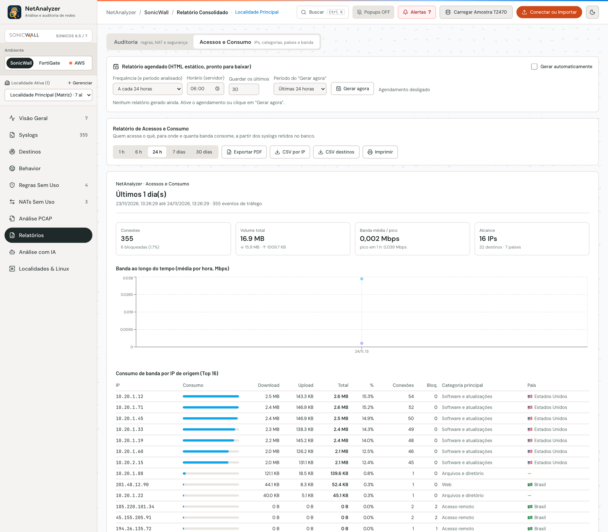

**Delivery reports (HTML):** set the client's name, logo and "prepared by" once per site/account (Reports → *Report identity*) and every HTML report — audit, access & consumption and the AWS delivery report (ALB, TLS connections, VPC Flow Logs, WAF) — gets a branded header. Logos are validated (PNG/JPEG/WebP only, ≤ 300 KB, no SVG).

**Access & Consumption** answers *who accessed what, to where, and how much bandwidth it used*:
top IPs, categories, countries, ASNs, destinations, hourly bandwidth timeline and per-IP consumption.

- **Scheduled generation** every 24 h, 3 days or 7 days — or a manual period from 1 h to 30 days.
- Runs **in the background with no time limit**; the file appears in the list when ready.
- Delivered as **static HTML** (elegant, self-contained, safe to e-mail), plus **PDF** and **CSV**.
- Retention of the last *N* reports per site.

The classic **Audit report** (rules, NAT, security posture) lives in the same screen (firewall environments).

---

## 🧭 Overview, alerts and security posture

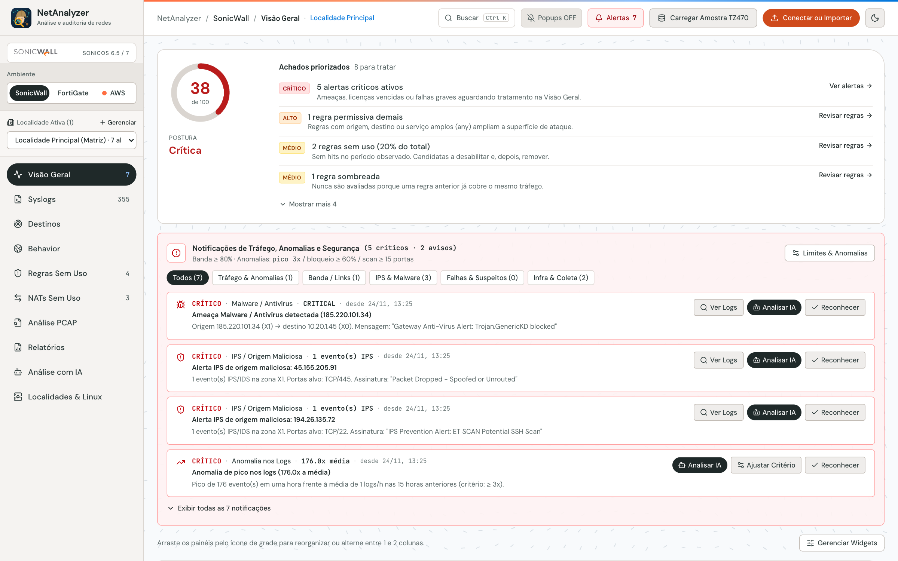

- **Posture score** (0–100) with prioritized findings: critical alerts, over-permissive rules, unused and shadowed rules.
- **Alert center** grouped by *Traffic & anomalies · Bandwidth & links · IPS & malware · Failures & suspects · Infra & collection*,
  with *View logs*, *Analyze with AI* and *Acknowledge* actions and tunable thresholds.
- Drag-and-drop widgets, light and dark themes, command palette (`Ctrl K`).

<table>
<tr>
<td width="50%"><b>FortiGate overview</b><br>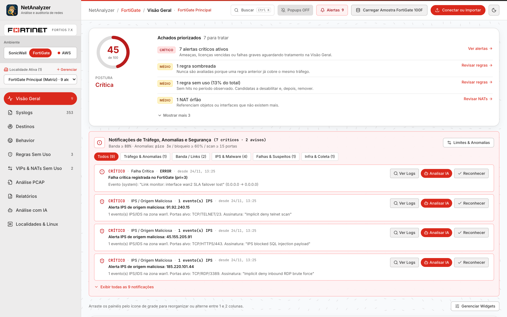</td>
<td width="50%"><b>Dark mode</b><br>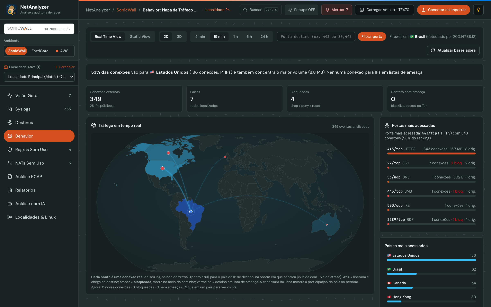</td>
</tr>
</table>

---

## 🗂️ Syslog and unused policies

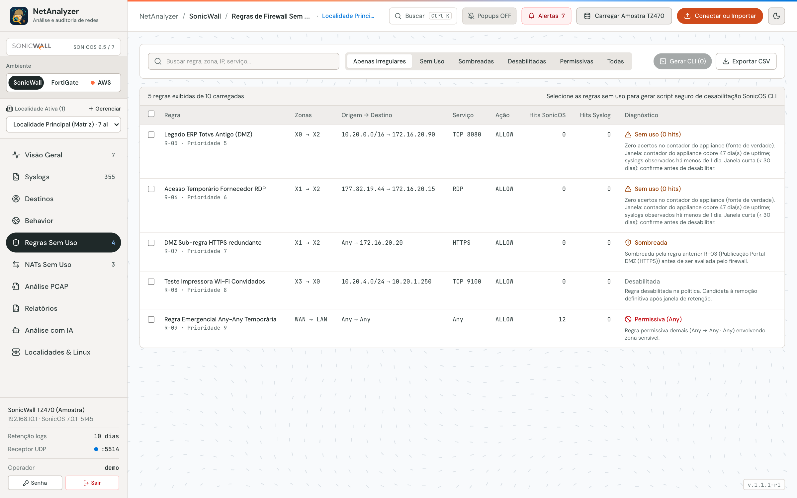

- **Syslog explorer** — fast search over millions of events (PostgreSQL + trigram index), filters by action, severity, text and destination port, with a **Reset Syslogs** button to restart analysis from zero (also clears alerts and metrics).
- **Unrecognized lines panel** — log lines the parser could not interpret are grouped by shape with real examples (and a copy button), so a new message type never disappears silently.
- **Destinations** — who your network talks to, resolved from the FQDN the firewall logged (falling back to reverse DNS), plus the *Sources* view of who consumes. Aggregated in the database over the whole period, with no event cap.
- **Unused rules / NATs** — SonicWall and FortiGate (policies, VIPs). Appliance hit counters win over syslog heuristics.
- **AI analyst** (optional, Gemini) — logs are **anonymized** before leaving the server; disabled if no key is set.

---

## ⚖️ Feature parity

Everything generic is available wherever it makes sense; only API- or log-specific logic differs.

| Capability | SonicWall | FortiGate | AWS |
|---|:---:|:---:|:---:|
| Overview, alert center | ✅ | ✅ | ✅ |
| Syslogs explorer + destination-port filter | ✅ | ✅ | ✅ |
| Port ranking | ✅ | ✅ | ✅ |
| Destinations / Sources radar | ✅ | ✅ | ✅ |
| **Behavior** (world map + heatmap, offline intel) | ✅ | ✅ | ✅ |
| **Access & Consumption** report + scheduler | ✅ | ✅ | ✅ |
| **PCAP analysis** | ✅ | ✅ | ✅ |
| **TV mode** and trend charts (ALB, VPC Flow Logs, WAF) | — | — | ✅ |
| Syslog receiver (UDP) | ✅ `5514` | ✅ `5515` | — |
| Pull from S3 (Flow Logs, WAF, ALB) | — | — | ✅ |
| Unused rules / NATs, audit report | ✅ | ✅ (VIPs) | — |
| **AI analyst** (context-aware per environment) | ✅ | ✅ | ✅ |
| CLI script export | ✅ | ✅ | — |
| Live sync via API | SonicOS REST | FortiOS REST v2 | — |

---

## 🚀 Quick start

Fresh Ubuntu server — the script installs Docker, generates the `.env` and brings everything up:

```bash
sudo apt-get update && sudo apt-get install -y git
git clone https://github.com/rgerios/NetAnalyzer-Agy.git ~/NetAnalyzer-Agy
cd ~/NetAnalyzer-Agy
./deploy.sh
```

Then open `https://<server-ip>` and create the administrator account.

| Command | What it does |
|---|---|
| `./deploy.sh` | Install what is missing, create `.env`, build and start (idempotent) |
| `./deploy.sh --update` | `git pull`, rebuild and restart |
| `./deploy.sh hml` | Staging environment (other folder/branch, ports `8443` / `5614` / `5615`) |
| `docker compose down -v && ./deploy.sh` | ⚠️ Start from scratch — **deletes the database** |

### Point the firewall at it

| Environment | Syslog target | Port |
|---|---|:---:|
| SonicWall | `<server-ip>` · UDP | `5514` |
| FortiGate | `<server-ip>` · UDP | `5515` |
| AWS | no syslog: add S3 sources in **Accounts & S3 sources** | — |

Tip (SonicWall): the *Connection Closed* events carry bytes sent/received — enable logging on your outbound
rules so the consumption reports have data.

### Try it without a firewall or AWS account

Click **Load sample** in the top bar (TZ470 for SonicWall, 100F for FortiGate, AWS sample for AWS) and every screen fills up with demo data.

---

## 🏗️ Architecture

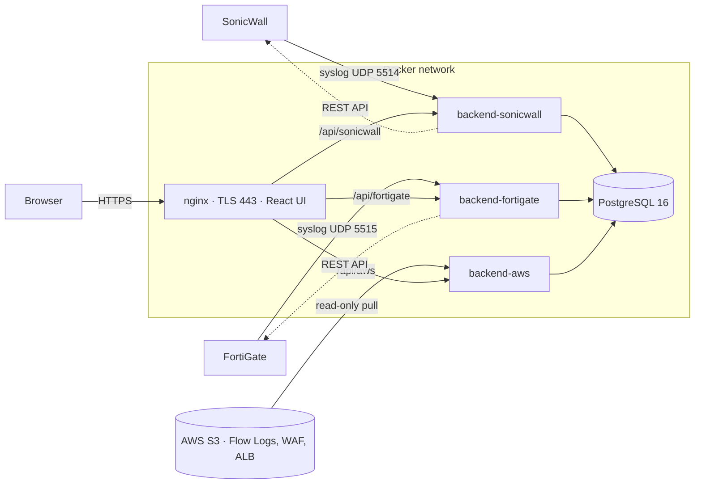

- **Frontend** — React 19, Vite, Tailwind, Recharts, d3-geo + TopoJSON (world map), jsPDF.
- **Backend** — Node.js + Express (TypeScript), one engine instance per environment, shared code in `shared/`.
- **Storage** — PostgreSQL 16 (syslogs, counters, hourly buckets, alerts, metrics); JSON file mode for light use.
- **nginx** — TLS only on `443`, loopback health check, DNS re-resolve so a rebuilt backend never causes a `502`; a dedicated large-body route for PCAP uploads.
- **Heavy queries stay in the database** — report and port aggregations run as SQL in read-only transactions.

### Configuration

| Variable | Purpose | Default |
|---|---|---|
| `FRONTEND_HTTPS_PORT` | HTTPS port | `443` |
| `SONICWALL_UDP_PORT` / `FORTIGATE_UDP_PORT` | Syslog ports | `5514` / `5515` |
| `GEMINI_API_KEY` | Enables the AI analyst (optional) | — |
| `INTEL_AUTO_UPDATE` | Automatic offline-database updates | `true` |
| `REPORT_QUERY_TIMEOUT_MS` | Interactive report query limit | `60000` |
| `REPORT_SCHEDULED_TIMEOUT_MS` | Scheduled report limit (`0` = unlimited) | `0` |
| `PCAP_MAX_FILE_MB` / `PCAP_MAX_PACKETS` | PCAP upload limits | `300` / `1000000` |
| `PG_SHARED_BUFFERS` / `PG_EFFECTIVE_CACHE_SIZE` / `PG_WORK_MEM` / `PG_MAINTENANCE_WORK_MEM` | PostgreSQL memory | filled by `deploy.sh` from the server RAM (never overwrites your values) |

---

## 🧪 Development

```bash
npm install
npm run dev          # API + UI (all three environments) on http://localhost:3000
npx tsc --noEmit     # type-check
npm test             # unit tests (node --test)
```

PostgreSQL integration tests run when `TEST_DATABASE_URL` is set.

**Release flow** — work on `hml`, validate in the staging stack, then promote to `main` (production) with a
fast-forward merge. Details in [`RELEASE.md`](RELEASE.md). Deployment guide: [`DEPLOY_DOCKER_UBUNTU.md`](DEPLOY_DOCKER_UBUNTU.md).

---

## 🔐 Security & privacy

- Self-hosted: logs, rules and reports stay on your server.
- TLS-only entry point, authenticated API, CSRF origin/fetch-metadata protection, scrypt-hashed passwords, per-site data isolation.
- Offline reputation/GeoIP — no destination IP is ever sent to a lookup service.
- AWS access is **read-only**; the Secret Access Key is encrypted at rest and never sent back to the browser.
- Outbound webhook and custom AI provider URLs are validated against SSRF (cloud metadata, loopback, internal containers).
- PCAP files live in memory only, with a size limit, an idle timeout and no disk persistence.
- AI analysis is opt-in and **anonymizes** data before sending.
- All HTML report downloads are served with a strict CSP and path-traversal guards.

---

## 🗺️ Roadmap

- [x] AWS: ALB **connection logs** (TLS handshakes and failures)
- [ ] AWS: Site-to-Site / Client VPN logs from CloudWatch
- [ ] AWS: Parquet Flow Logs, multi-account AssumeRole management, Firehose push for high volume
- [ ] SonicWall CPU / memory / connections via additional SonicOS API endpoints
- [ ] Richer destination categories from FQDN hints in the aggregated report
- [ ] OS agents (Windows / Linux) shipping logs to the same platform — *planned for a later phase*
- [ ] More sources beyond firewalls and AWS (other clouds, switches, Wi-Fi, DNS, servers): NetAnalyzer is meant to grow into a general network-investigation platform

---

<div align="center">

Built for people who read logs so that others don't have to. 🛡️

</div>
