<div align="center">


# NetAnalyzer

### Investigue sua rede: firewalls, logs de nuvem e tráfego em um só lugar

*Perícia de rede ao estilo Sherlock.* Transforme logs brutos em respostas: quais regras estão mortas, quem consome a banda, quais portas
realmente são usadas, para onde o tráfego vai, o que está falhando atrás do balanceador e o que há de errado numa captura de pacotes — em um único painel self-hosted.
Hoje cobre **SonicWall**, **FortiGate** e **AWS** (ALB, VPC Flow Logs, WAF); novas fontes estão no roadmap.

[](#-início-rápido)
[](#-arquitetura)
[](#-arquitetura)
[](#-arquitetura)
[](#-ambientes)
[](#-behavior-mapa-múndi-e-mapa-de-calor)

[English](README.md) · **Português**

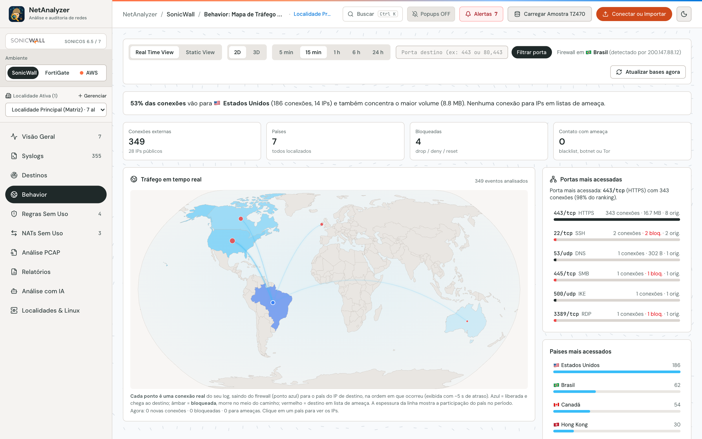

</div>

---

## ✨ Por que o NetAnalyzer

Redes e nuvens produzem logs mais rápido do que alguém consegue ler. O NetAnalyzer conecta no appliance (API),
recebe o syslog dele, lê seus logs da AWS no S3 e entrega as visões que um auditor ou engenheiro de rede realmente
precisa — sem enviar nenhum log para serviços de terceiros.

| | |
|---|---|
| 🔎 **Achar regras mortas** | Regras e NATs sem uso, usando os contadores do próprio appliance como fonte da verdade. |
| 🌍 **Ver para onde o tráfego vai** | Mapa-múndi em tempo real e mapa de calor por país, feitos com suas conexões reais. |
| 🔌 **Conhecer as portas** | Portas de destino mais acessadas e filtro por porta de destino em Syslogs, Destinos e Behavior. |
| 📊 **Saber quem consome o quê** | Banda por IP, categoria, país e destino. |
| 🧪 **Depurar capturas de pacotes** | Envie `.pcap` / `.pcapng` e filtre com expressões no estilo Wireshark; receba causas prováveis automaticamente. |
| ☁️ **Ler seus logs da AWS** | VPC Flow Logs, AWS WAF e ALB direto do S3, nas mesmas telas dos firewalls. |
| 🚨 **Alertas que importam** | Picos anômalos, eventos de IPS/malware, varreduras, saturação de link, licença e falhas de sincronização. |
| 📑 **Entregar relatórios** | Relatório de auditoria e de Acessos e Consumo, agendados, em HTML estático, PDF e CSV. |
| 🔒 **Manter a privacidade** | Self-hosted. GeoIP, ASN e reputação funcionam **offline**. |

---

## 🧩 Ambientes

Uma interface, três ambientes, alternados na barra lateral. Cada um roda no seu container, com dados próprios.

| | SonicWall | FortiGate | AWS |
|---|---|---|---|
| **Origem dos logs** | Syslog UDP `5514` + API SonicOS | Syslog UDP `5515` + API FortiOS | VPC Flow Logs, WAF e ALB lidos do **S3** |
| **Direção do tráfego** | Saída para a internet | Saída para a internet | Clientes de entrada e fluxos de saída |
| **Auditoria de regras / NAT** | ✅ | ✅ (políticas, VIPs) | — |
| **Todo o resto** | Syslogs, Destinos, Behavior, Portas, PCAP, Relatórios, Alertas | igual | igual (sem analista de IA) |

---

## 🌐 Behavior: mapa-múndi e mapa de calor

Cada ponto no mapa é **uma conexão real** do seu log, saindo em direção ao país de destino, na ordem em que ocorreu.
Azul = liberada e entregue, âmbar = bloqueada (morre no meio do caminho), vermelho = destino em lista de ameaça.
O país de origem é detectado automaticamente (na AWS vem da região).

<table>
<tr>
<td width="50%"><b>Visão em tempo real</b><br></td>
<td width="50%"><b>Visão estática — mapa de calor por país</b><br>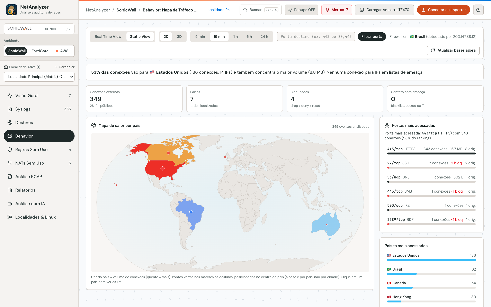</td>
</tr>
</table>

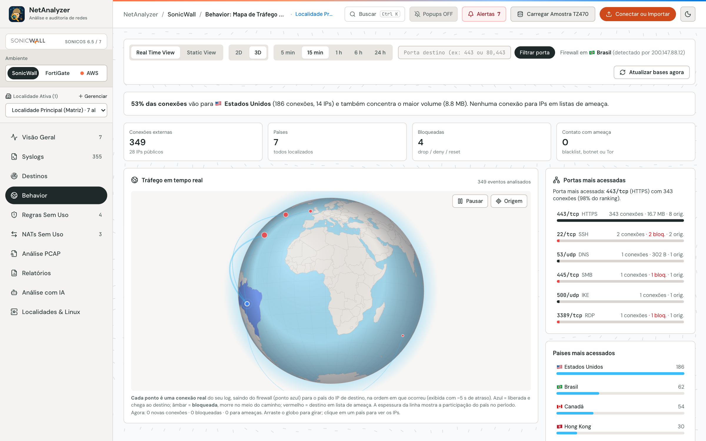

- **2D ou 3D** — alterne entre o mapa plano e um **globo 3D giratório** (arraste para girar, pause, recentralize na origem). As conexões reais voam em arcos nas duas visões.
- **Período inteiro, sem teto de eventos** — em janelas longas o banco agrega todas as conexões (com cache e atualização em segundo plano), então o mapa cobre o período completo e não só os eventos mais recentes.
- **GeoIP / ASN / reputação offline** — sem API por consulta, sem limites, nada sai da sua rede.
  Fontes: [DB-IP Lite](https://db-ip.com/db/lite.php) (CC BY 4.0), [FireHOL Level 1](https://iplists.firehol.org/),
  [Spamhaus DROP](https://www.spamhaus.org/drop/), [abuse.ch Feodo Tracker](https://feodotracker.abuse.ch/) e a lista de saída do Tor.
- **Atualização com um clique** (*Atualizar bases agora*), além de atualização automática diária (listas) e mensal (GeoIP).
- Janelas de **5 minutos a 24 horas**; clique em um país para listar seus IPs.
- Resumo em linguagem natural no topo: *"53% das conexões vão para Estados Unidos… nenhuma conexão para IPs em listas de ameaça."*

> Precisão por país, por design: as bases são offline e gratuitas; as posições são o centro de cada país.

---

## 🔌 Portas: mais acessadas e filtro por porta de destino

Syslogs, Destinos e Behavior compartilham as mesmas ferramentas de porta.

<table>
<tr>
<td width="50%"><b>Syslogs</b> — ranking + filtro por porta<br>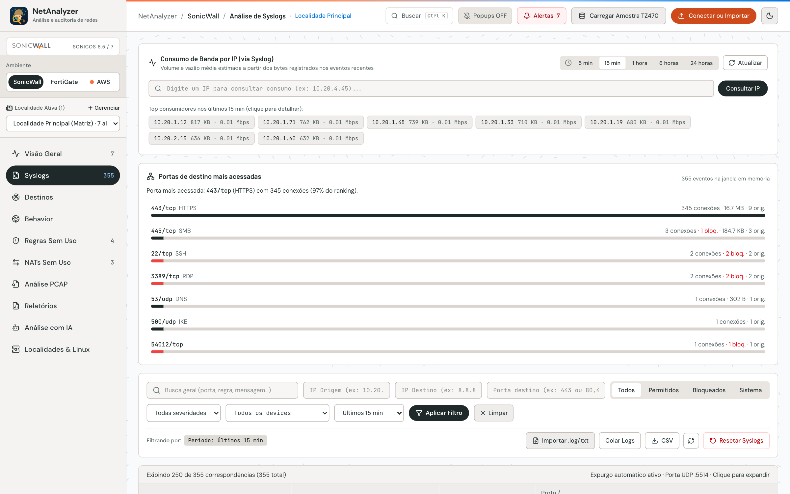</td>
<td width="50%"><b>Destinos</b> — ranking + filtro por porta<br>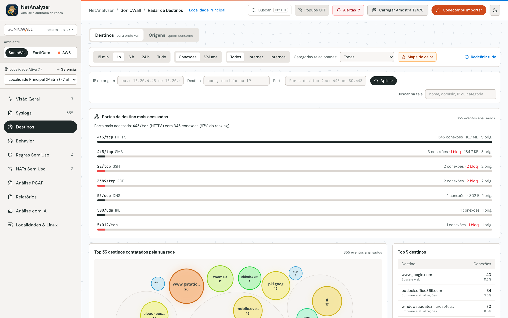</td>
</tr>
</table>

- **Ranking** das portas de destino com o nome do serviço (HTTPS, SSH, RDP…), conexões, parcela bloqueada, volume e origens distintas.
  O destaque diz em palavras: *"Porta mais acessada: 443/tcp (HTTPS) com 345 conexões."*
- **Clique numa porta para filtrar**; clique de novo para remover. O ranking continua mostrando as alternativas com o filtro ativo.
- **Campo de filtro por porta** aceita `443`, listas (`80,443`) e intervalos (`8000-8100`), combinados (`22,8000-8100`).
- Nos Syslogs o ranking é calculado no banco, sobre todo o período escolhido.

---

## ☁️ Ambiente AWS

Leia seus logs de nuvem direto do **S3 ou do CloudWatch Logs** e veja nas mesmas telas dos firewalls.

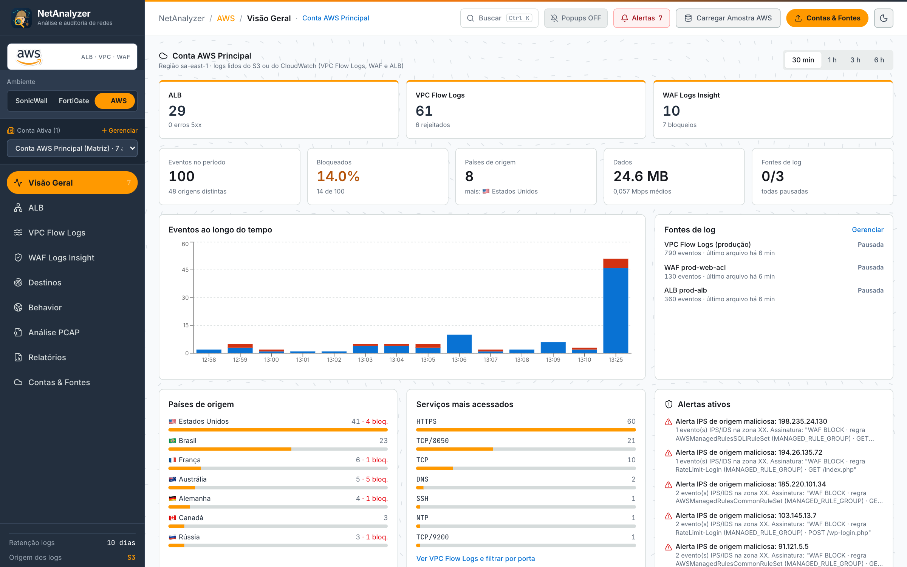

<table>
<tr>
<td width="33%"><b>ALB</b><br>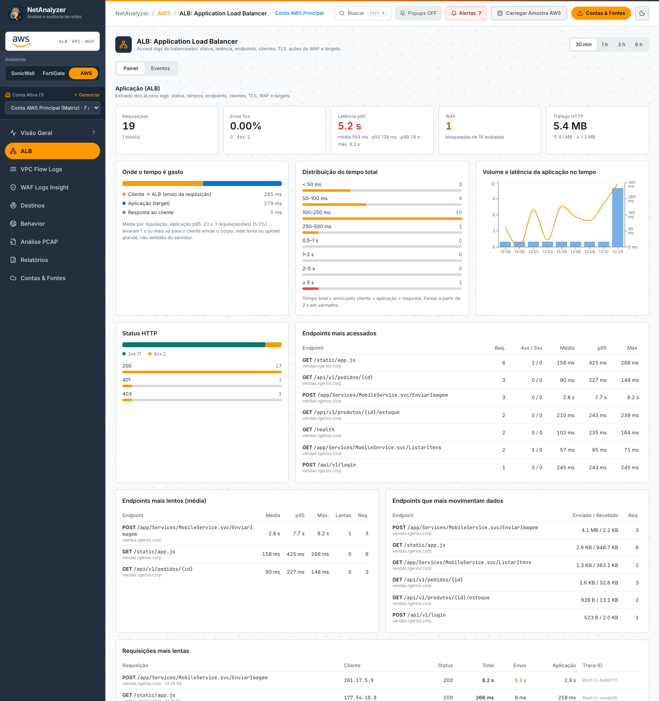</td>
<td width="33%"><b>VPC Flow Logs</b><br>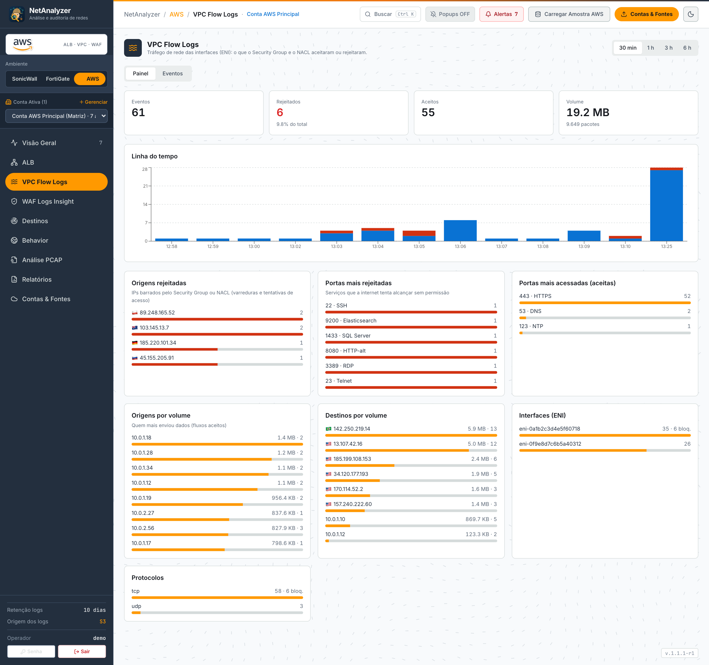</td>
<td width="33%"><b>WAF Logs Insight</b><br>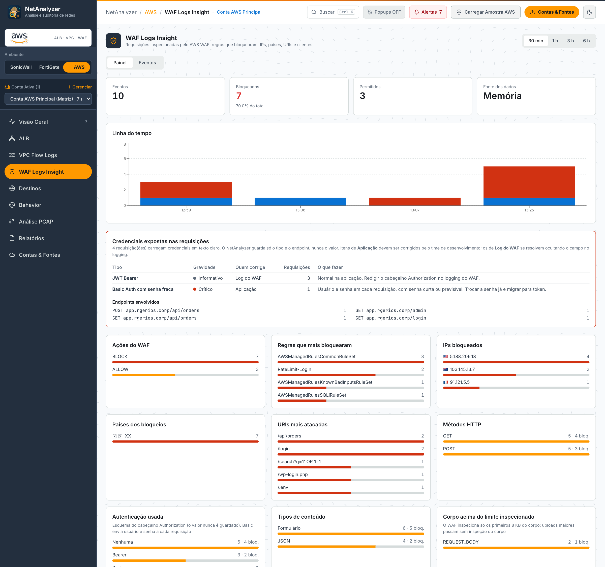</td>
</tr>
</table>

<table>
<tr>
<td width="50%"><b>Behavior</b> — clientes por país, origem pela região<br>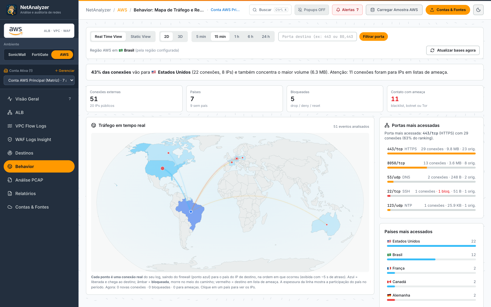</td>
<td width="50%"><b>Contas &amp; fontes S3</b><br>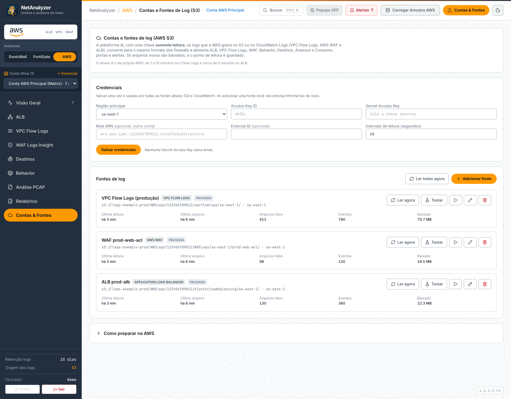</td>
</tr>
</table>

| Log | Formato lido | O que você ganha |
|---|---|---|
| **VPC Flow Logs** | texto, padrão ou campos personalizados (`pkt-srcaddr`, `flow-direction`…) | ACCEPT/REJECT, IPs, portas, protocolo, bytes; varreduras de porta contra suas instâncias |
| **AWS WAF** | JSON, uma requisição por linha | ALLOW/BLOCK, regra que bloqueou, IP e país do cliente, Host |
| **Application Load Balancer** | access log: texto (S3, `.gz`) ou JSON (CloudWatch) | cliente, host, método, caminho, status, 3 tempos, TLS, user-agent, ação do WAF, target, bytes de entrada/saída |

- **S3 ou CloudWatch Logs:** cada fonte lê um bucket ou um log group. No CloudWatch, o **prefixo do stream** (ex.: `ALB_Access_Logs/`) separa tipos de log que dividem o mesmo grupo, então os logs de conexão e de health check ficam de fora.
- **Menu:** o ambiente AWS tem uma página por recurso — **ALB**, **VPC Flow Logs** e **WAF Logs Insight** — cada uma com painel (tops e linha do tempo) e explorador de eventos; além de Destinos, Behavior, PCAP, Relatórios e Contas & Fontes. O log group e o prefixo de stream são escolhidos com um botão de atualizar que lista os existentes na AWS.
- **Análise da aplicação (ALB):** uma seção completa com status HTTP, latência, endpoints mais usados / mais lentos / que mais movimentam dados (ids agrupados como `{id}`), endpoints com erro, user-agents, versões e cifras de TLS, ações do WAF e saúde por target. Todos os campos também ficam no evento e aparecem no detalhe do Syslog.
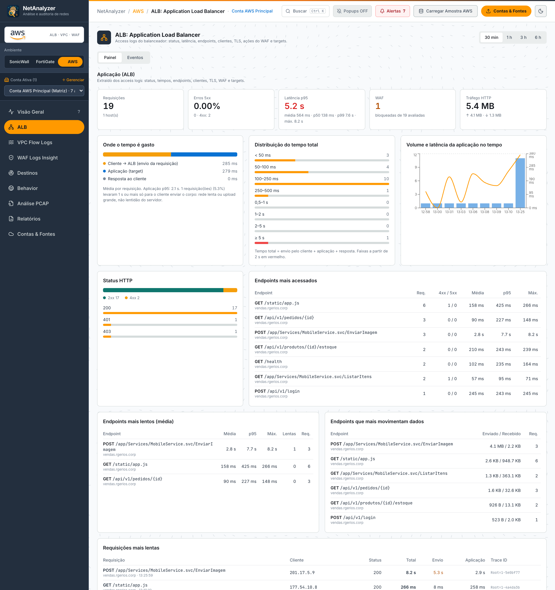

- **Latência de verdade:** p50 / p95 / p99, onde o tempo é gasto (cliente → ALB, aplicação, resposta), distribuição de tempo, p95 por endpoint, linha do tempo de latência e 5xx e as requisições individuais mais lentas com o Trace ID. Tempos longos de "envio" aparecem como upload lento do cliente, não como servidor lento.
- **Connection logs (TLS):** latência do handshake, versão do TLS e troca de chaves (inclusive pós-quântica `X25519MLKEM768`) e conexões que não concluíram o TLS.
- **Segredos nunca guardados:** `Authorization`, cookies, chaves de API e parâmetros de query com cara de token são redigidos antes de gravar ou exibir; só o *esquema* de autenticação (Bearer, Basic, SigV4…) vira métrica.
- **Como funciona:** a cada ~60 s (configurável) a plataforma lista só os objetos **novos** de cada fonte, baixa, descompacta, converte para o evento comum
  e ingere. O ponto de leitura é guardado, então reiniciar nunca repete nem perde arquivos. A primeira leitura volta uma janela configurável (padrão 6 h).
- **Acesso somente leitura:** usuário IAM com `s3:ListBucket` + `s3:GetObject` no prefixo dos logs. O secret fica **criptografado** e nunca volta para o navegador.
  **AssumeRole + ExternalId** opcional para outra conta.
- **Teste antes de salvar:** valida credenciais, bucket e prefixo e tenta reconhecer o formato de um objeto de amostra, com mensagens claras para
  `AccessDenied`, região errada, chave inválida e outras.
- **Entende o tráfego de entrada:** no Behavior e nos relatórios de acesso o IP público do cliente é o lado remoto, então o mapa mostra *quem está chegando até você*.
- **O atraso é o da própria AWS:** 1–10 min nos Flow Logs, ~5 min no ALB. A entrega mais barata é o S3 (cerca da metade do custo da ingestão no CloudWatch).
- Sem receptor UDP e sem regras/NATs: o ambiente AWS mostra só o que vem dos logs da nuvem. **Carregar Amostra AWS** enche todas as telas com dados de demonstração.

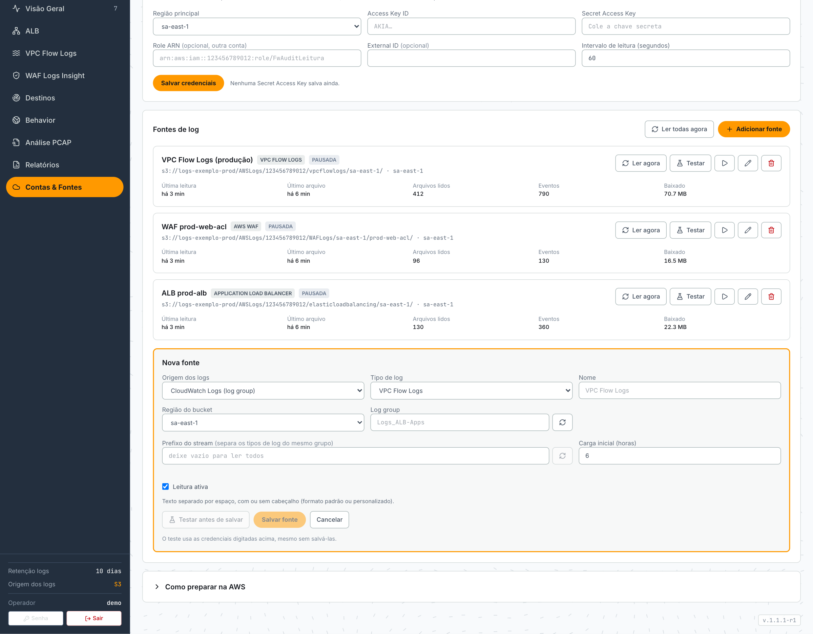

---

## 🧪 Análise de PCAP

Envie capturas do Wireshark ou tcpdump e depure com **filtros de exibição no estilo Wireshark**, sem instalar nada.

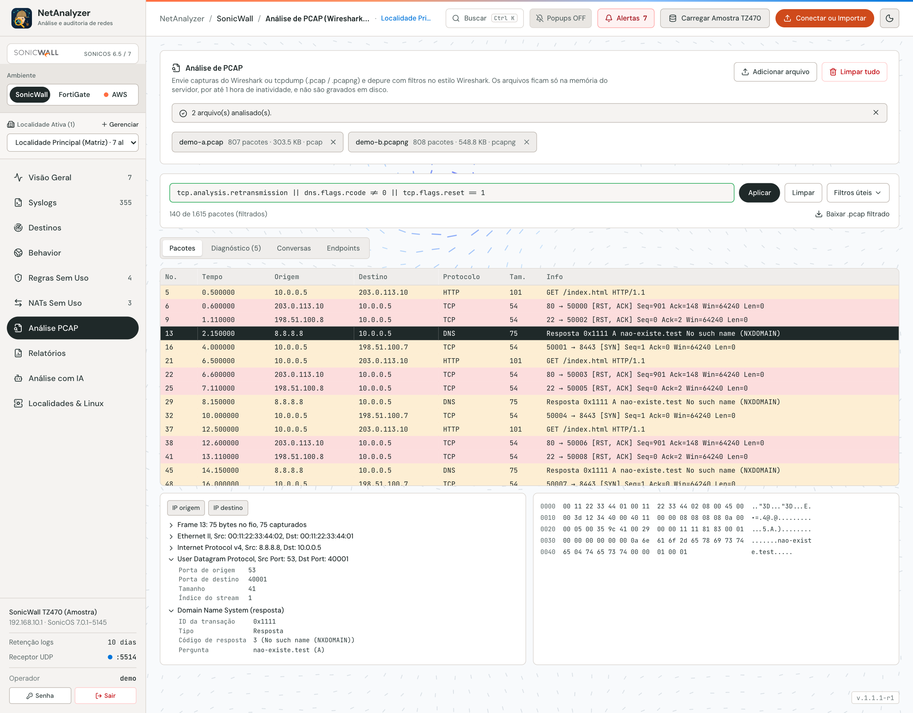

- **Vários arquivos** (`.pcap` e `.pcapng`, little/big-endian, µs/ns) mesclados por horário; ficam **só na memória do servidor**, por até 1 h sem uso.
- **Filtros:** `ip.addr == 10.0.0.0/8`, `tcp.port in {80 443}`, `tcp.flags.syn == 1 && tcp.flags.ack == 0`, `dns.qry.name contains "microsoft"`,
  `tls.handshake.extensions_server_name`, `http.response.code >= 400`, `tcp.analysis.retransmission`, `tcp contains "texto"` e mais.
  Operadores `== != > < >= <= contains matches in {…}`, lógica `&& || !` (ou `and / or / not`), CIDR em campos de IP. Menu de filtros úteis e erros claros para campos desconhecidos.
- **Lista de pacotes** colorida por problema e protocolo, árvore de camadas e hexdump, **Seguir stream TCP**, conversas e endpoints, e **Baixar .pcap filtrado** para abrir no Wireshark.
- **Diagnóstico com causas prováveis** (clique em *Ver pacotes* para ir ao filtro exato):

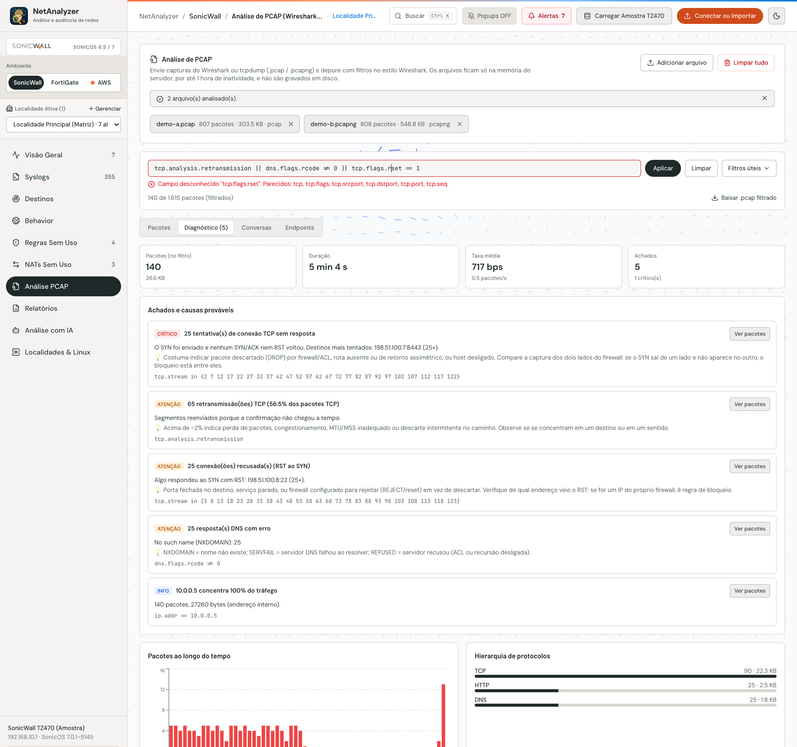

| Achado | O que costuma significar |
|---|---|
| SYN sem resposta | Pacote descartado por firewall/ACL, rota ausente ou host fora do ar |
| RST em resposta ao SYN | Porta fechada, serviço parado ou firewall configurado para rejeitar |
| Retransmissões, janela zero, ACKs duplicados | Perda, congestionamento, MTU/MSS, receptor lento |
| Erros de DNS / consultas sem resposta | NXDOMAIN, SERVFAIL, REFUSED, UDP/53 bloqueado |
| ICMP "administrativamente proibido" | Bloqueio explícito de firewall |
| Handshake TLS sem Server Hello / alertas TLS | Bloqueio por SNI/categoria, problema de inspeção SSL, MTU |
| ARP sem resposta, fragmentos IP | VLAN/IP errados; MTU/MSS em túneis |

> O motor é uma implementação em TypeScript, sem dependências, então os filtros são um **subconjunto suportado** do Wireshark (campos desconhecidos são avisados). Os streams TCP não são totalmente remontados.

---

## 📑 Relatórios: auditoria + acessos e consumo

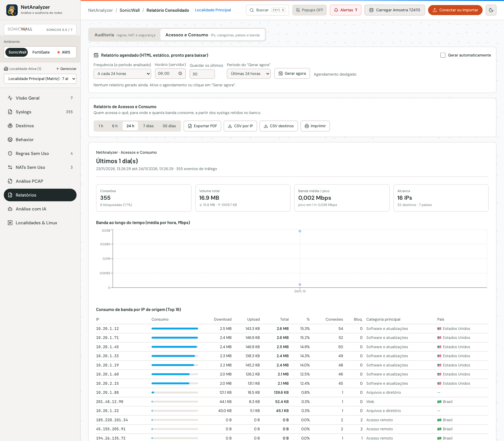

**Acessos e Consumo** responde *quem acessou o quê, para onde e quanta banda usou*:
IPs, categorias, países, ASNs e destinos mais acessados, linha do tempo de banda por hora e consumo por IP.

- **Geração agendada** a cada 24 h, 3 ou 7 dias — ou período manual de 1 h a 30 dias.
- Roda **em segundo plano, sem limite de tempo**; o arquivo aparece na lista quando fica pronto.
- Entregue em **HTML estático** (elegante, autocontido, seguro para enviar por e-mail), além de **PDF** e **CSV**.
- Retenção dos últimos *N* relatórios por localidade.

O **relatório de Auditoria** clássico (regras, NAT, postura de segurança) fica na mesma tela (ambientes de firewall).

---

## 🧭 Visão geral, alertas e postura de segurança

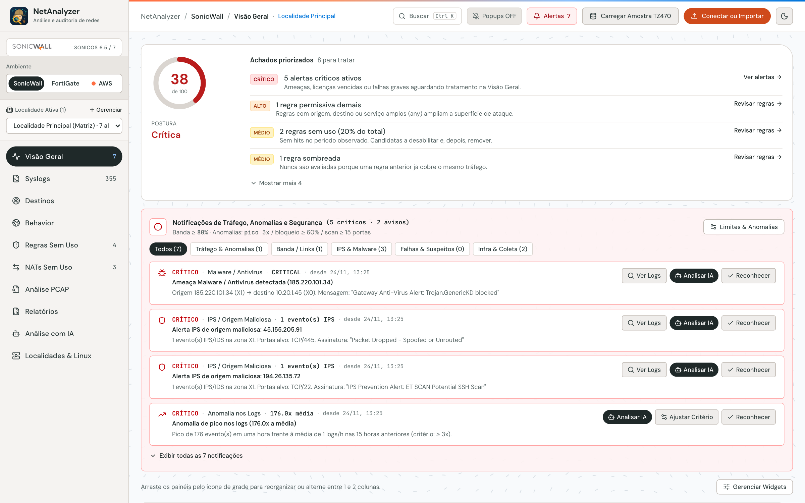

- **Nota de postura** (0–100) com achados priorizados: alertas críticos, regras permissivas demais, sem uso e sombreadas.
- **Central de alertas** agrupada em *Tráfego e anomalias · Banda e links · IPS e malware · Falhas e suspeitos · Infra e coleta*,
  com ações *Ver logs*, *Analisar IA* e *Reconhecer*, e limites ajustáveis.
- Widgets arrastáveis, temas claro e escuro, paleta de comandos (`Ctrl K`).

<table>
<tr>
<td width="50%"><b>Visão geral do FortiGate</b><br>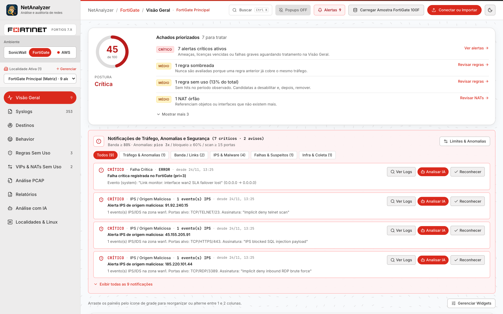</td>
<td width="50%"><b>Modo escuro</b><br>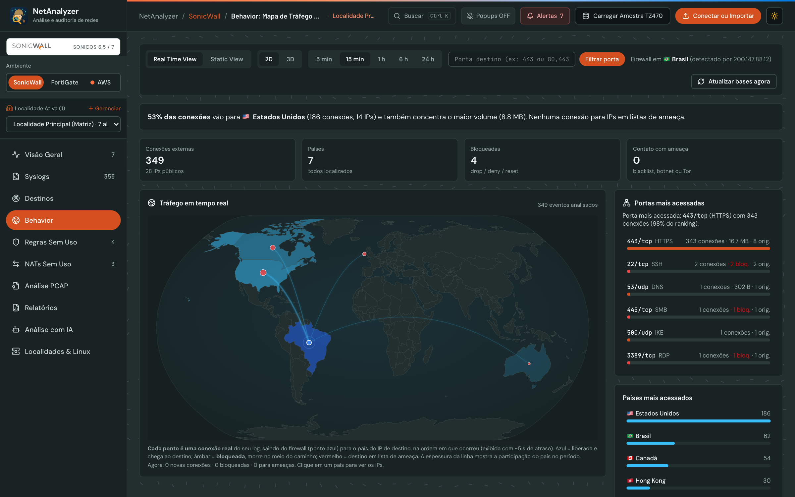</td>
</tr>
</table>

---

## 🗂️ Syslog e políticas sem uso

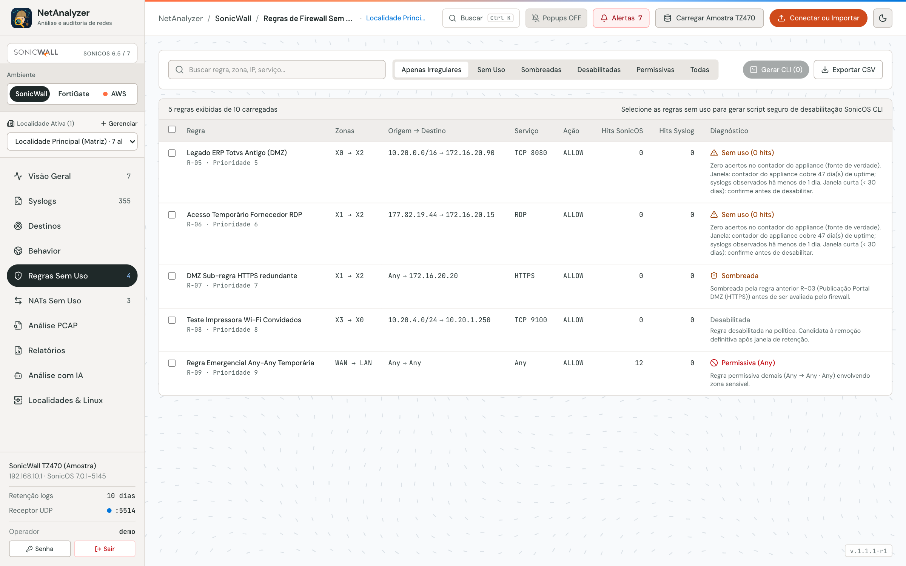

- **Explorador de syslog** — busca rápida em milhões de eventos (PostgreSQL + índice trigram), filtros por ação, severidade, texto e porta de destino, com botão **Resetar Syslogs** para recomeçar a análise do zero (limpa também alertas e métricas).
- **Painel de linhas não reconhecidas** — linhas que o analisador não conseguiu interpretar aparecem agrupadas por tipo, com exemplos reais (e botão de copiar), para que um tipo de mensagem novo nunca suma em silêncio.
- **Destinos** — com quem sua rede conversa, resolvido pelo FQDN que o firewall registrou no log (com DNS reverso como reserva), além da visão de *Origens* (quem consome). Agregado no banco sobre o período inteiro, sem teto de eventos.
- **Regras / NATs sem uso** — SonicWall e FortiGate (políticas, VIPs). Os contadores do appliance valem mais que a heurística de syslog.
- **Analista de IA** (opcional, Gemini) — os logs são **anonimizados** antes de sair do servidor; desligado se não houver chave.

---

## ⚖️ Paridade entre ambientes

Tudo que é genérico existe onde faz sentido; só muda o que depende da API ou do tipo de log.

| Recurso | SonicWall | FortiGate | AWS |
|---|:---:|:---:|:---:|
| Visão geral, central de alertas | ✅ | ✅ | ✅ |
| Explorador de syslogs + filtro por porta de destino | ✅ | ✅ | ✅ |
| Ranking de portas | ✅ | ✅ | ✅ |
| Radar de Destinos / Origens | ✅ | ✅ | ✅ |
| **Behavior** (mapa-múndi + calor, inteligência offline) | ✅ | ✅ | ✅ |
| Relatório **Acessos e Consumo** + agendador | ✅ | ✅ | ✅ |
| **Análise de PCAP** | ✅ | ✅ | ✅ |
| Receptor de syslog (UDP) | ✅ `5514` | ✅ `5515` | — |
| Leitura do S3 (Flow Logs, WAF, ALB) | — | — | ✅ |
| Regras / NATs sem uso, relatório de auditoria | ✅ | ✅ (VIPs) | — |
| Analista de IA, exportação de script CLI | ✅ | ✅ | — |
| Sincronização ao vivo via API | SonicOS REST | FortiOS REST v2 | — |

---

## 🚀 Início rápido

Ubuntu zerado — o script instala o Docker, gera o `.env` e sobe tudo:

```bash
sudo apt-get update && sudo apt-get install -y git
git clone https://github.com/rgerios/NetAnalyzer.git ~/NetAnalyzer
cd ~/NetAnalyzer
./deploy.sh
```

Depois abra `https://<ip-do-servidor>` e crie a conta de administrador.

| Comando | O que faz |
|---|---|
| `./deploy.sh` | Instala o que falta, cria o `.env`, constrói e sobe (pode repetir sem risco) |
| `./deploy.sh --update` | `git pull`, reconstrói e reinicia |
| `./deploy.sh hml` | Ambiente de homologação (outra pasta/branch, portas `8443` / `5614` / `5615`) |
| `docker compose down -v && ./deploy.sh` | ⚠️ Recomeçar do zero — **apaga o banco** |

### Aponte o firewall para ele

| Ambiente | Destino do syslog | Porta |
|---|---|:---:|
| SonicWall | `<ip-do-servidor>` · UDP | `5514` |
| FortiGate | `<ip-do-servidor>` · UDP | `5515` |
| AWS | sem syslog: cadastre fontes S3 em **Contas & Fontes S3** | — |

Dica (SonicWall): os eventos *Connection Closed* trazem bytes enviados/recebidos — habilite o log nas regras de
saída para os relatórios de consumo terem dados.

### Teste sem um firewall nem conta AWS

Clique em **Carregar Amostra** na barra superior (TZ470 no SonicWall, 100F no FortiGate, amostra AWS no AWS) e todas as telas se enchem com dados de demonstração.

---

## 🏗️ Arquitetura

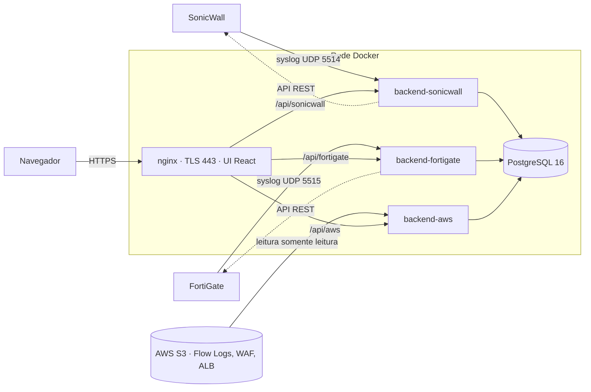

- **Frontend** — React 19, Vite, Tailwind, Recharts, d3-geo + TopoJSON (mapa), jsPDF.
- **Backend** — Node.js + Express (TypeScript), uma instância do motor por ambiente, código comum em `shared/`.
- **Armazenamento** — PostgreSQL 16 (syslogs, contadores, buckets por hora, alertas, métricas); modo arquivo JSON para uso leve.
- **nginx** — só TLS na `443`, health check em loopback e re-resolução de DNS para que recriar um backend nunca cause `502`; rota dedicada de corpo grande para o upload de PCAP.
- **Consultas pesadas ficam no banco** — as agregações de relatório e de portas rodam como SQL em transação somente leitura.

### Configuração

| Variável | Para que serve | Padrão |
|---|---|---|
| `FRONTEND_HTTPS_PORT` | Porta HTTPS | `443` |
| `SONICWALL_UDP_PORT` / `FORTIGATE_UDP_PORT` | Portas de syslog | `5514` / `5515` |
| `GEMINI_API_KEY` | Habilita o analista de IA (opcional) | — |
| `INTEL_AUTO_UPDATE` | Atualização automática das bases offline | `true` |
| `REPORT_QUERY_TIMEOUT_MS` | Limite da consulta de relatório interativo | `60000` |
| `REPORT_SCHEDULED_TIMEOUT_MS` | Limite do relatório agendado (`0` = ilimitado) | `0` |
| `PCAP_MAX_FILE_MB` / `PCAP_MAX_PACKETS` | Limites do upload de PCAP | `300` / `1000000` |
| `PG_SHARED_BUFFERS` / `PG_EFFECTIVE_CACHE_SIZE` / `PG_WORK_MEM` / `PG_MAINTENANCE_WORK_MEM` | Memória do PostgreSQL | preenchidas pelo `deploy.sh` conforme a RAM do servidor (nunca sobrescreve o que você definiu) |

---

## 🧪 Desenvolvimento

```bash
npm install
npm run dev          # API + UI (os três ambientes) em http://localhost:3000
npx tsc --noEmit     # checagem de tipos
npm test             # testes unitários (node --test)
```

Os testes de integração com PostgreSQL rodam quando `TEST_DATABASE_URL` está definida.

**Fluxo de release** — trabalhe na `hml`, valide no ambiente de homologação e promova para a `main` (produção) com
merge fast-forward. Detalhes em [`RELEASE.md`](RELEASE.md). Guia de deploy: [`DEPLOY_DOCKER_UBUNTU.md`](DEPLOY_DOCKER_UBUNTU.md).

---

## 🔐 Segurança e privacidade

- Self-hosted: logs, regras e relatórios ficam no seu servidor.
- Entrada somente TLS, API autenticada, senhas com hash scrypt e isolamento de dados por localidade.
- Reputação/GeoIP offline — nenhum IP de destino é enviado a serviço de consulta.
- O acesso à AWS é **somente leitura**; a Secret Access Key fica criptografada em repouso e nunca volta para o navegador.
- Arquivos PCAP ficam só na memória, com limite de tamanho, tempo ocioso e nenhuma gravação em disco.
- A análise por IA é opcional e **anonimiza** os dados antes do envio.
- Os downloads de relatório saem com CSP restrita e proteção contra path traversal.

---

## 🗺️ Roadmap

- [ ] AWS: **logs de conexão** do ALB (falhas de TLS) e logs de VPN Site-to-Site / Client VPN pelo CloudWatch
- [ ] AWS: Flow Logs em Parquet, gestão de várias contas com AssumeRole, entrega por Firehose para alto volume
- [ ] CPU / memória / conexões do SonicWall via endpoints adicionais da API SonicOS
- [ ] Categorias de destino mais ricas a partir de FQDN no relatório agregado
- [ ] Agentes de S.O. (Windows / Linux) enviando logs para a mesma plataforma — *planejado para uma fase futura*
- [ ] Mais fontes além de firewalls e AWS (outras nuvens, switches, Wi-Fi, DNS, servidores): o NetAnalyzer foi pensado para crescer como plataforma geral de investigação de rede

---

<div align="center">

Feito para quem lê logs para que os outros não precisem. 🛡️

</div>
